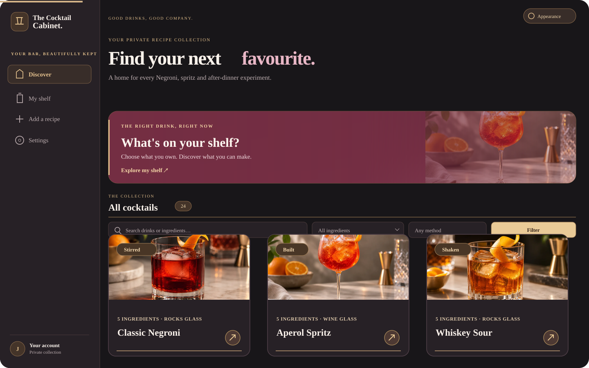

<p align="center">
  
</p>

<h1 align="center">The Cocktail Cabinet</h1>

<p align="center">
  <strong>Your private bar, beautifully kept.</strong><br>
  A self-hosted cocktail collection that knows what's on your shelf.
</p>

<p align="center">
  <strong>Flask + SQLite</strong> · <strong>Docker</strong> · <strong>Installable PWA</strong> · <strong>REST API + MCP</strong>
</p>

---

## A look inside



<sub>Illustrated interface preview based on the application's current Bordeaux-and-champagne design. The recipe photos shown are bundled public sample assets, not screenshots of a private account. Recipe counts and content will differ between installations.</sub>

The collection is built around real drink photography:

| Gin & tonic | Classic Negroni | Aperol Spritz |
|:---:|:---:|:---:|
|  |  |  |

The interface includes **light and dark modes**, a spacious desktop sidebar, a compact mobile navigation bar and a consistent Bordeaux-and-champagne visual language. Recipe cards follow the photography's 4:3 format; typography, surfaces and controls are designed to stay readable on phones as well as larger screens.

## What you can do

| Area | Features |
| --- | --- |
| **Discover** | Search by cocktail or ingredient, filter by category or preparation method, and open full recipes with photos, measurements and instructions. |
| **My Shelf** | Mark specific bottles or generic ingredient categories as owned. Browse a nested, searchable hierarchy and see which cocktails you can make. Each user has their own shelf. |
| **Recipe availability** | Individual recipe ingredients receive a quiet champagne accent and checkmark when matched by your shelf, along with an essential-ingredient availability indicator. Exact bottle ownership and category-based matches are distinguished. |
| **Recipes** | Add and edit cocktails, ingredients, steps, garnishes, classifications and photos. Members manage their recipes; administrators can manage the entire collection. |
| **Ingredient catalogue** | Classify bottles into one or more categories. Category changes update recipe labels and shelf matching without guessing from brand names. |
| **Accounts** | Private sign-in, first-run administrator setup, account management, optional invitation emails and single-use invitation links. No public sign-up. |
| **Integrations** | Personal read-only or read/write REST tokens, a remote MCP connector, recipe-image transfer and per-user shelf updates. |
| **PWA** | Install the site from a supported mobile browser over HTTPS; follow the system theme or choose your own. |

The initial database ships with **22 curated cocktails and 105 ingredient lines**. It is a starting collection, not a limit: members can add recipes and administrators can organize the catalogue. Seeded photos are included, and a recipe's own uploaded photo takes precedence.

### Matching is based on what you actually have

A recipe calling for generic **Gin** can match a suitable owned gin bottle or generic gin shelf selection. A recipe asking for a **particular branded bottle** is not automatically treated as satisfied by a different brand. Ingredients can belong to multiple category branches (for example, London Dry Gin and Citrus Gin).

On a recipe page, the availability accents are deliberately subtle: a light champagne wash, narrow edge, compact checkmark and a small progress indicator. The separate preparation checkboxes are still manual—they never change your shelf. **Ice is assumed available** and is not offered as a shelf item. Optional ingredients and garnishes do not block a cocktail's ready-to-make status.

## Deploy with Docker or Synology Container Manager

The production deployment is a single service in [`compose.yaml`](compose.yaml) using the image:

```text
ghcr.io/shuach613/cocktail-cabinet:latest
```

**Requirements:** a Docker host running Linux/amd64 (including a compatible Synology NAS), Docker Compose or Container Manager, persistent storage and—recommended for real use—an HTTPS reverse proxy. The published GitHub Actions image targets **linux/amd64**. The app's internal port is `8080`; the supplied Compose file exposes NAS port **`1931`**.

No `.env` file or manually generated application secret is required for the supplied Compose deployment.

### Option A: Synology Container Manager

1. Open **Container Manager → Project → Create**. Choose a project name such as `cocktail-cabinet` and a directory such as `/volume1/docker/cocktail-cabinet`.
2. Choose to create a project from a Compose file and paste the contents of [`compose.yaml`](compose.yaml).
3. Start the project. Keep its named `cabinet_data` volume: this is where accounts, recipes, uploads and secrets live.
4. Set up **DSM → Login Portal → Advanced → Reverse Proxy** to forward an HTTPS hostname to `http://127.0.0.1:1931` on your NAS (adjust the destination to the NAS address appropriate to your setup).
5. In the container logs, find **`One-time administrator setup key:`**. The key is sensitive; don't share it or publish it.
6. Visit `https://YOUR-HOSTNAME/setup` and use that key to create the first administrator. Then sign in and begin building your shelf.

If your GHCR package requires authentication, configure access to the package on the Docker host first. Registry permissions are independent of Cocktail Cabinet accounts.

### Option B: SSH / Docker Compose

Save [`compose.yaml`](compose.yaml) in your intended project directory and run:

```bash
cd /volume1/docker/cocktail-cabinet
sudo docker compose pull
sudo docker compose up -d --remove-orphans
sudo docker logs cocktail-cabinet 2>&1 | grep 'One-time administrator setup key:'
```

Use the printed key **only on the initial setup screen**. If an administrator already exists, the one-time key is no longer generated and the setup route remains closed.

### Configuration

The supplied Compose file contains these commonly adjusted settings:

| Setting | Default | Purpose |
| --- | --- | --- |
| Host port | `1931:8080` | Change the left-hand port if needed. |
| `DATA_DIR` | `/data` | Persistent application data inside the container. |
| `COOKIE_SECURE` | `true` | Secure session cookies; keep enabled behind HTTPS. |
| `TRUST_PROXY` | `true` | Honor headers from your trusted reverse proxy. |
| `SMTP_*` | Unset | Optional email delivery for invitations. Without SMTP, copy the invitation URL yourself. |

Only set `COOKIE_SECURE=false` and `TRUST_PROXY=false` when intentionally testing on an HTTP-only trusted local environment. Do **not** expose the application's unencrypted HTTP listener directly to the public internet.

### Persistent data, updates and backup

The named volume mounted at `/data` contains:

- `cabinet.sqlite3` — accounts, recipes, categories, shelves, invitations and API credentials.
- `uploads/` — uploaded cocktail photographs.
- `.session-secret` — persistent cookie-signing secret.
- `.admin-setup-token` — temporary setup token, removed after administrator creation.

Update in place:

```bash
cd /volume1/docker/cocktail-cabinet
sudo docker compose pull
sudo docker compose up -d --remove-orphans
```

**Back up the entire `cabinet_data` volume before upgrading**, including hidden files and uploaded photos. For a consistent backup, stop writes and copy the volume or use SQLite's online backup functionality together with a separate upload-file backup. Keep the same Compose project/volume. **Never use `docker compose down -v` for a routine update**; that removes named volumes.

Database initialization and migrations are automatic and designed to preserve user-created content, recipe references and per-account shelf selections. Existing installations do **not** require another first-run administrator setup.

## Using the app

### The ingredient shelf

Choose either **a particular bottle** (for example, a named gin or amaretto) or **any item in a generic category** (for example, Indian tonic). Saved selections are private to your account. The matching engine categorizes recipes as ready to make, missing one ingredient, or missing more ingredients.

The curated hierarchy currently includes specialist gin subtypes (London Dry, Citrus and Specialty), whisky including separate Bourbon and Single Malt, tonic types (Indian, Pepper and Mediterranean), and other ingredient families. You can extend or reorganize categories as an administrator.

### Recipe creation and editing

In **Add a recipe**, enter the title, method, glassware, ingredients, exact quantities and ordered instructions. For a new ingredient, choose its categories or create a nested subcategory during the same edit. You can also upload a JPEG, PNG or WebP image (up to 4 MB); the server processes uploaded photos into private WebP files.

The collection includes a **Settings → Manage recipes** screen for editing, replacing images or removing entries. Administrators can edit all recipes; regular members can edit their own.

### Invitations and privacy

Only administrators can invite people or manage accounts. Invitations are single-use, email-bound and valid for seven days unless used or revoked. SMTP is optional, so the app can operate without an email provider. Recipe pages, uploaded photos and API data require authentication; the service worker only caches public static assets, **not your private collection**.

## REST API

The authenticated JSON API lives at **`/api/v1/`**. Create personal credentials in **Settings → API access**, choosing read-only or read/write permissions. Tokens inherit the permissions of the account that created them. Never put tokens in a public repository, URL query string or chat message.

| Resource | Main endpoints |
| --- | --- |
| Recipes | `GET /api/v1/recipes`, `GET /api/v1/recipes/{id}`, `POST /api/v1/recipes`, `PATCH /api/v1/recipes/{id}`, `DELETE /api/v1/recipes/{id}` |
| Recipe images | `GET /api/v1/recipes/{id}/image`, `POST /api/v1/recipes/{id}/image`, `DELETE /api/v1/recipes/{id}/image` |
| Ingredients and categories | `GET /api/v1/ingredients`, `GET /api/v1/categories`, plus permission-controlled management endpoints |
| Personal shelf | `GET /api/v1/shelf`, `POST /api/v1/shelf/items`, `PATCH /api/v1/shelf/items` |
| Account and sync | `GET /api/v1/me`, `GET /api/v1/changes` |
| API schema | `GET /api/v1/openapi.json` |

Example: retrieve your recipes (replace the hostname and token locally):

```bash
curl -H "Authorization: Bearer YOUR_PERSONAL_TOKEN" \
  "https://YOUR-HOSTNAME/api/v1/recipes?page=1&per_page=50"
```

Mark one item as owned:

```bash
curl -X POST "https://YOUR-HOSTNAME/api/v1/shelf/items" \
  -H "Authorization: Bearer YOUR_WRITE_TOKEN" \
  -H "Content-Type: application/json" \
  -d '{"ingredient_id":12,"owned":true}'
```

Bulk shelf changes use `PATCH /api/v1/shelf/items` with a `changes` array of up to 100 operations. They **do not replace unrelated owned items** and never change shared recipes or ingredient classifications.

A lightweight revision check lets visible browser pages refresh after API/MCP changes, usually within about **five seconds**. Pending shelf edits and active recipe preparation checklists are protected from disruptive automatic refreshes.

## Connect ChatGPT or another MCP client

The app includes a **Streamable HTTP MCP endpoint at `/mcp`**, hosted by the same Flask service—no additional container, database or port.

- **ChatGPT:** use the custom MCP connection flow available in your ChatGPT account, supply `https://YOUR-HOSTNAME/mcp` and authorize through Cocktail Cabinet's OAuth account-linking page. Your permissions stay tied to the account you approve.
- **Other compatible clients:** a personal API token can be supplied as a bearer credential over HTTPS.
- **Tools:** read/create/update/delete recipes according to permissions; browse ingredients and categories; download or replace recipe photos; and inspect or update the connected user's own shelf via `get_my_shelf`, `set_shelf_item_owned` and `update_my_shelf`.

See [MCP connector setup and troubleshooting](docs/MCP_CONNECTOR.md) for the detailed OAuth flow, examples and security considerations. Availability of custom connectors and write actions depends on the client's supported capabilities.

## Full management API

The REST API also supports the administrator-only catalogue and account
operations available in the website, plus dependency-safe bulk operations:

- `PATCH /api/v1/ingredients/{id}` — rename, recategorise or update brand status.
- `GET /api/v1/ingredients/{id}` and `GET /api/v1/categories/{id}` — inspect dependencies before changing or deleting.
- `POST /api/v1/ingredients/{id}/merge` and `POST /api/v1/categories/{id}/merge` — transfer associated recipe references, category links and eligible owned shelf selections.
- `DELETE /api/v1/ingredients/{id}` and `DELETE /api/v1/categories/{id}` — reject deletion while references remain; do not silently destroy recipes or shelves.
- `POST /api/v1/catalog/batch` — atomic multi-operation catalogue updates.
- `GET /api/v1/recommendations` and `GET /api/v1/recipes/{id}/availability` — the authenticated user's recipe-readiness results.
- `GET/POST /api/v1/users`, `PATCH /api/v1/users/{id}`, `POST /api/v1/users/{id}/reset-password` — administrative member management.
- `GET/POST /api/v1/invitations` and `DELETE /api/v1/invitations/{id}` — invitations and revocation.
- `PATCH /api/v1/me`, `POST /api/v1/me/password`, `GET/POST /api/v1/tokens`, `DELETE /api/v1/tokens/{id}` — personal profile and credential management.

Every write still requires a **write-scoped token**, and shared catalogue and
member administration require an **administrator** account. All API actions
reuse the same SQLite data as the website. Existing recipes and ownership
records are preserved during merges, and a rejected batch rolls back entirely.

The ChatGPT MCP connector exposes catalogue maintenance, invitation management,
account-status administration and recipe-readiness tools as well. To avoid
leaking credentials into chats, operations that create or change passwords or
issue personal API tokens remain REST-/website-only.

See [the complete OpenAPI reference](docs/openapi.json) and
[MCP connector guide](docs/MCP_CONNECTOR.md) for precise schemas and safety
rules. Refresh the installed connector's tools after deploying an updated image.

## Visual system and responsive review

The UI follows the existing **Bordeaux-and-Champagne** palette and **Lato**
typography, with one coordinated design language for light/dark modes and
desktop/mobile layouts. The [visual system guide](docs/VISUAL_SYSTEM.md)
documents interface structure, colour/spacing rules, and review criteria.

A separate [responsive visual QA workflow](.github/workflows/visual-review.yml)
captures ten representative screens at five viewport widths in both themes
using Chromium and a temporary local database. Screenshots and the browser
report are downloadable as GitHub Actions artifacts on design pull requests.

## Development

The app deliberately uses a small stack: **Python 3.12, Flask, Werkzeug, SQLite, Gunicorn, Pillow, Jinja templates, CSS and minimal JavaScript**. It has no separate frontend build process or external database requirement.

### Run locally with Python

```bash
python -m venv .venv
. .venv/bin/activate
pip install -r requirements-dev.txt
DATA_DIR="$(mktemp -d)" COOKIE_SECURE=false TRUST_PROXY=false python app.py
```

### Build the container locally

```bash
docker compose -f compose.yaml -f compose.local.yaml up -d --build
```

### Run tests

```bash
python -m pytest -q
```

GitHub Actions runs the test suite on pull requests and builds/publishes the GHCR image on pushes to `main` after tests pass.

### Project map

```text
app.py                  Browser routes, accounts and recipe pages
db.py                   SQLite schema, seed data and matching
catalog.py              Curated ingredient taxonomy
shelf_api.py             Per-user owned-ingredient logic
api.py                   Authenticated REST endpoints
mcp_connector.py         MCP endpoint and tools
templates/               Server-rendered pages
static/                  Light/dark styles, scripts, icons and PWA assets
seed/                    Starter cocktails and public sample photos
tests/                   Integration and regression tests
compose.yaml             Production Docker deployment
docs/MCP_CONNECTOR.md    MCP and OAuth integration guide
```

## Security notes

Cocktail Cabinet is designed as a **small private installation**, not a multi-tenant public SaaS platform. It uses hashed passwords and credentials, CSRF protection for browser mutations, scoped API access, secure cookie defaults, restricted media access and a persistent server-side secret.

Use TLS, strong passwords, restricted NAS administrator access and a proper backup strategy. The app does not provide a general email-based password-reset service or distributed authentication rate limiting; consider reverse-proxy rate limiting when exposing it externally. Avoid sharing setup keys, API tokens or OAuth callback URLs.

---

<p align="center">
  <strong>Good drinks. A well-kept shelf. Your own collection.</strong>
</p>
